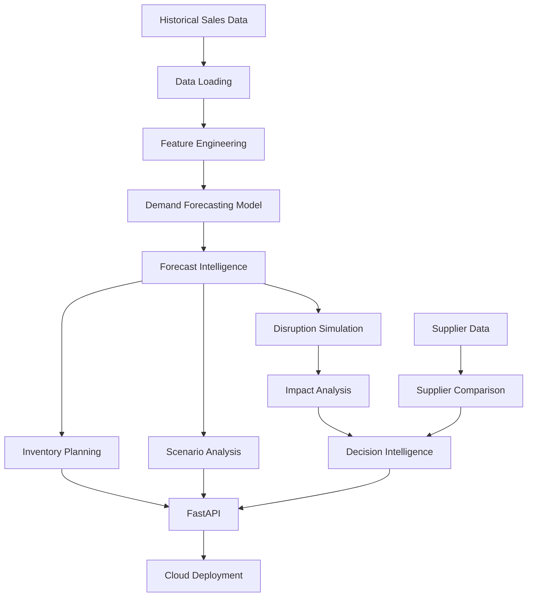
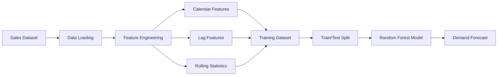
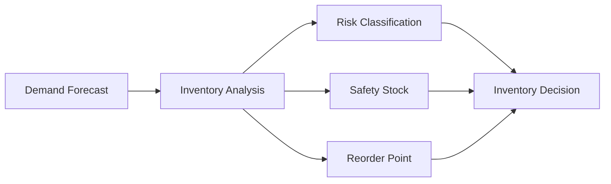
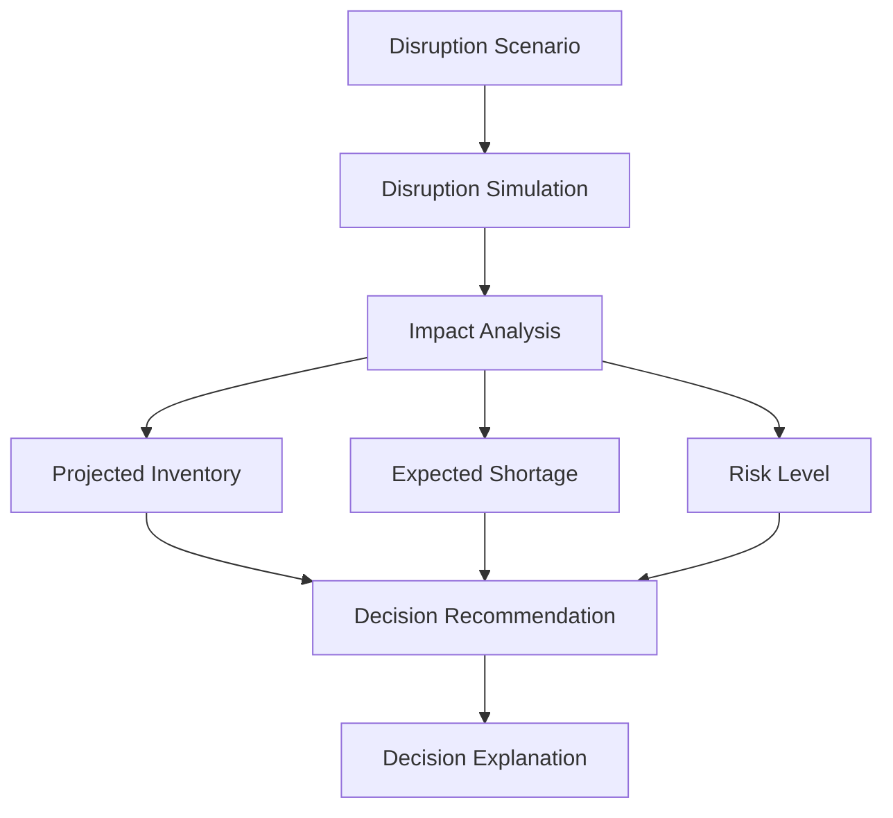
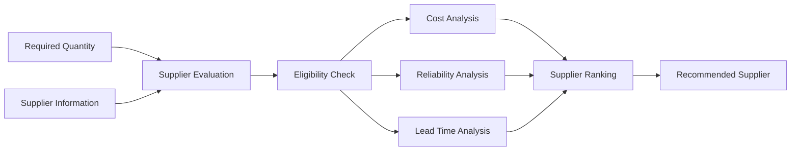
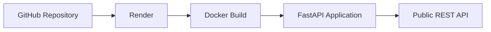

# NEXUS Supply Chain Intelligence

> AI-powered demand forecasting and supply chain decision intelligence platform.

<div align="center">

<a href="https://nexus-supply-chain.streamlit.app">
  
</a>

<a href="https://nexus-supply-chain-intelligence.onrender.com/docs">
  
</a>

<a href="https://github.com/shubhamkardel-ai/nexus-supply-chain-intelligence">
  
</a>

<br/><br/>

**AI-powered demand forecasting · inventory intelligence · supply chain decision support**

</div>

[](https://www.python.org/)
[](https://fastapi.tiangolo.com/)
[](https://scikit-learn.org/)
[](https://www.docker.com/)
[](https://render.com/)
[](https://nexus-supply-chain-intelligence.onrender.com/docs)

**NEXUS Supply Chain Intelligence** transforms historical sales data into demand forecasts, inventory insights, disruption analysis, supplier comparisons, and actionable supply chain recommendations.

**Live API:** https://nexus-supply-chain-intelligence.onrender.com  
**API Documentation:** https://nexus-supply-chain-intelligence.onrender.com/docs

---

## Overview

Modern supply chains require more than demand predictions. Teams need to understand inventory risk, evaluate disruptions, compare suppliers, and make informed operational decisions.

NEXUS combines machine learning forecasting with supply chain intelligence to support that workflow.

### Core capabilities

- Demand forecasting using a Random Forest model
- Leakage-aware feature engineering
- Inventory status and reorder planning
- Forecast scenario analysis
- Batch and multi-day forecasting
- Supply chain disruption simulation
- Disruption impact analysis
- Decision recommendations and explanations
- Supplier comparison and procurement analytics
- REST API with interactive documentation
- Docker-based cloud deployment

---

## System Architecture



The architecture separates forecasting, inventory intelligence, disruption analysis, decision support, and supplier optimization into modular services.

---

## Machine Learning Pipeline

The forecasting pipeline converts historical sales records into model-ready features.



### Feature engineering

The pipeline uses historical demand signals including:

| Feature Category | Examples |
|---|---|
| Calendar | Date-based demand patterns |
| Lag Features | `lag_1`, `lag_7` |
| Rolling Features | `rolling_mean_7`, `rolling_mean_30` |
| Historical Signals | Previous sales behavior |

These features allow the model to learn demand patterns from historical observations.

---

## Demand Forecasting

The system uses a **Random Forest regression model** to estimate future product demand.

The forecasting engine provides:

- Predicted demand
- Forecast reporting
- Batch predictions
- Multi-day forecasts
- Scenario-based analysis

### Model evaluation

The current project dataset contains:

| Metric | Result |
|---|---:|
| Products | 20 |
| Historical records | 7,300 |
| Training records | 5,840 |
| Test records | 1,460 |
| Mean Absolute Error | 14.43 |
| Root Mean Squared Error | 18.93 |

---

## Inventory Intelligence

Forecasts are converted into operational inventory insights.



The inventory engine supports:

- Inventory status analysis
- Reorder planning
- Safety stock calculation
- Risk classification
- Recommended procurement actions

---

## Disruption and Decision Intelligence

NEXUS extends beyond forecasting by simulating supply chain disruptions and evaluating their operational impact.



### Decision workflow

The intelligence pipeline supports:

1. Simulating a supply chain disruption
2. Measuring inventory and shortage impact
3. Assessing operational risk
4. Generating a recommendation
5. Providing an explanation for the recommended decision

This provides a structured workflow from **event → impact → recommendation → explanation**.

---

## Supplier Procurement Intelligence

The supplier comparison capability helps evaluate procurement options based on operational requirements.

Supplier analysis considers available supplier information such as:

- Unit cost
- Reliability
- Lead time
- Available capacity
- Minimum order quantity



The system identifies suppliers that meet procurement requirements and ranks eligible options.

---

## API

The platform exposes its capabilities through a FastAPI REST API.

### Core endpoints

| Method | Endpoint | Description |
|---|---|---|
| `GET` | `/` | API root |
| `GET` | `/health` | Service health check |
| `GET` | `/inventory/status` | Inventory status analysis |
| `POST` | `/inventory/plan` | Inventory planning |
| `POST` | `/scenario` | Forecast scenario analysis |
| `GET` | `/forecast/report` | Forecast reporting |
| `POST` | `/forecast` | Demand forecasting |
| `POST` | `/forecast/batch` | Batch forecasting |
| `POST` | `/forecast/multi-day` | Multi-day forecasting |

### Supply chain intelligence endpoints

| Method | Endpoint | Description |
|---|---|---|
| `POST` | `/disruption/simulate` | Simulate supply chain disruptions |
| `POST` | `/impact/analyze` | Analyze disruption impact |
| `POST` | `/decision/recommend` | Generate a supply chain recommendation |
| `POST` | `/decision/explain` | Explain the recommended decision |
| `POST` | `/suppliers/compare` | Compare and rank suppliers |
| `POST` | `/suppliers/analytics` | Analyze supplier procurement data |

### Interactive API documentation

The deployed Swagger interface is available at:

https://nexus-supply-chain-intelligence.onrender.com/docs

---

## Technology Stack

| Layer | Technology | Purpose |
|---|---|---|
| Programming Language | Python 3.11 | Application development |
| Data Processing | Pandas | Sales data analysis |
| Machine Learning | Scikit-learn | Demand forecasting |
| ML Model | Random Forest | Demand prediction |
| API | FastAPI | REST API |
| API Server | Uvicorn | Application serving |
| Testing | Pytest | Automated testing |
| Containerization | Docker | Reproducible deployment |
| Cloud Platform | Render | Production API hosting |

---

## Project Structure

```text
nexus-supply-chain-intelligence/
│
├── app/
│   └── forecast_api.py
│
├── data/
│   └── sales.csv
│
├── models/
│   └── disruption.py
│
├── services/
│   ├── data_loader.py
│   ├── demand_features.py
│   ├── forecast_model.py
│   ├── disruption_service.py
│   ├── impact_analysis_service.py
│   ├── decision_service.py
│   ├── decision_explanation_service.py
│   └── supply_chain_optimizer.py
│
├── tests/
│
├── Dockerfile
├── requirements.txt
└── README.md
```

The project follows a modular structure that separates API orchestration, data processing, forecasting, supply chain intelligence, and automated testing.

---

## Run Locally

### 1. Clone the repository

```bash
git clone https://github.com/shubhamkardel-ai/nexus-supply-chain-intelligence.git
cd nexus-supply-chain-intelligence
```

### 2. Create a virtual environment

```bash
python -m venv .venv311
```

### 3. Activate the environment

**Windows PowerShell:**

```powershell
.venv311\Scripts\Activate.ps1
```

### 4. Install dependencies

```bash
pip install -r requirements.txt
```

### 5. Start the API

```bash
python -m uvicorn app.forecast_api:app --reload
```

The API will be available locally at:

```text
http://127.0.0.1:8000
```

Interactive documentation:

```text
http://127.0.0.1:8000/docs
```

---

## Docker Deployment

Build the Docker image:

```bash
docker build -t nexus-supply-chain-intelligence .
```

Run the container locally:

```bash
docker run --rm -p 8000:8000 nexus-supply-chain-intelligence
```

The containerized API will be available at:

```text
http://localhost:8000
```

---

## Production Deployment

The API is deployed on Render using Docker.



### Production links

**Live API:** https://nexus-supply-chain-intelligence.onrender.com

**Swagger Documentation:** https://nexus-supply-chain-intelligence.onrender.com/docs

> The Render free instance may spin down during inactivity. The first request after inactivity can take longer because the service needs to restart.

---

## Testing

The project includes automated tests covering forecasting and supply chain intelligence functionality.

Run the test suite with:

```bash
python -m pytest -v
```

Testing covers areas including:

- Forecast generation
- Inventory planning
- Scenario analysis
- Disruption simulation
- Impact analysis
- Decision recommendations
- Decision explanations
- Supplier comparison and ranking
- API validation and error handling

---

## Engineering Principles

### Modular Architecture

Core services are separated by responsibility to improve maintainability and testability.

### API-First Design

Supply chain intelligence capabilities are exposed through a documented REST API.

### Explainable Decisions

Decision recommendations can be accompanied by structured explanations.

### Production-Oriented Development

The application supports local development, automated testing, Docker containerization, and cloud deployment.

---

## Future Improvements

Potential future enhancements include:

- Real-time demand data ingestion
- Advanced time-series forecasting models
- Model monitoring and drift detection
- Supplier performance history
- Interactive analytics dashboards
- Authentication and role-based access control
- CI/CD automation
- Cloud monitoring and observability

---

## Live Project

**NEXUS Supply Chain Intelligence**

AI-powered forecasting and decision intelligence for modern supply chain operations.

- **Live API:** https://nexus-supply-chain-intelligence.onrender.com
- **API Documentation:** https://nexus-supply-chain-intelligence.onrender.com/docs
- **Source Code:** https://github.com/shubhamkardel-ai/nexus-supply-chain-intelligence

---

## Author

**Shubham Kardel**

Aspiring AI/ML Engineer · Python Developer · AI Systems Builder

[GitHub](https://github.com/shubhamkardel-ai)